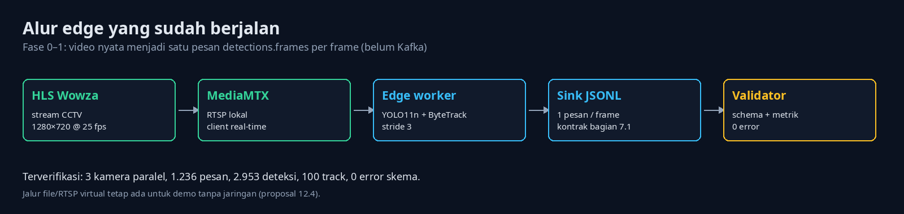
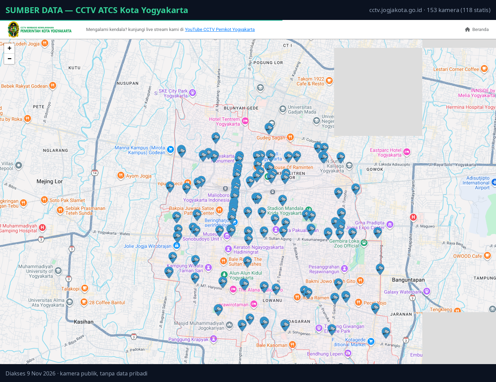
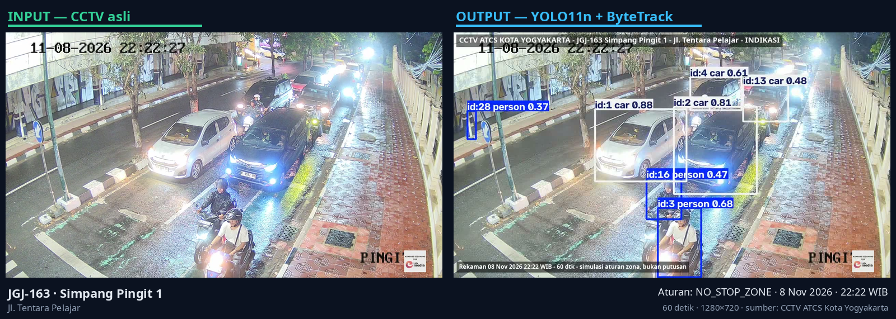
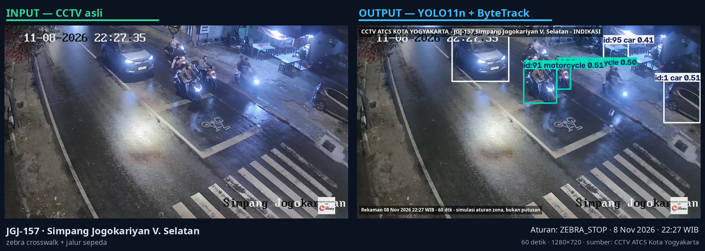
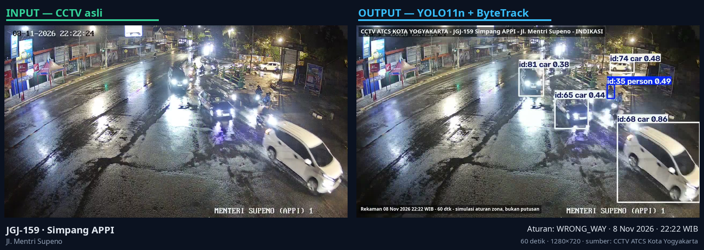
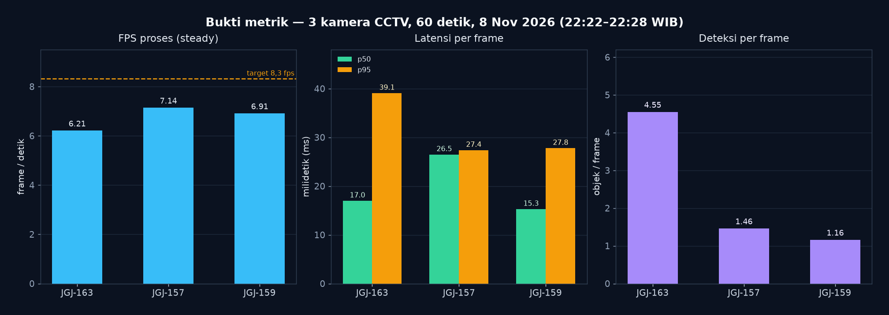

# Laporan Progres 1 — Traffic Violation Mesh

**Fase 0–1: edge (video → deteksi), sebelum Kafka/Flink/ClickHouse**

| | |
|---|---|
| Tanggal | 9 November 2026 |
| Mata kuliah | Big Data — Tugas 2 |
| Status | Fase 0–1 selesai; siap masuk Fase 2 (aturan pelanggaran) |
| Repo | `~/Projects/kuliah/dabd/Projek-DABD` |
| Model | `yolo11n.pt`, `imgsz=640`, `conf=0.35`, ByteTrack |
| Perangkat | RTX 4050 Laptop 6 GB, torch 2.15 + CUDA 13.2 |
| Sumber data | CCTV ATCS Kota Yogyakarta (publik) |

## 1. Ringkasan

Sisi *edge* sudah berjalan end-to-end dengan video nyata: tiga kamera CCTV publik
Yogyakarta ditarik lewat MediaMTX, diproses YOLO11n + ByteTrack, lalu ditulis sebagai
**satu pesan `detections.frames` per frame** sesuai kontrak proposal bagian 7.1.

Hasil sesi rekaman malam 8 November 2026:

- **1.236 pesan**, **2.953 deteksi**, **100 track unik**, **0 error validasi skema**.
- **6,2–7,1 fps** per kamera pada sesi rekaman yang sama, latensi **p50 15–27 ms** (catatan beban di §4.3).
- **0 read error** dari ketiga stream; tidak ada frame timestamp yang mundur.
- Bukti video: 3 klip asli + 3 klip beranotasi (60 detik) + GIF pratinjau, tersimpan di `clips/`.

Yang **belum** ada di fase ini: Kafka, Flink, ClickHouse, aturan pelanggaran, dan dashboard.
Laporan ini fokus pada bukti bahwa pipa deteksi dan kontrak datanya sudah valid.

## 2. Yang sudah dikerjakan

| # | Pekerjaan | Bukti |
|---|---|---|
| 1 | Kontrak data `detections.frames` (JSON Schema) + validator | `edge/schema/detections.frames.json`, `edge/metrics.py` |
| 2 | Worker video/RTSP → YOLO + ByteTrack → JSONL, dengan warmup split, pacing, dan metrik per stage | `edge/worker.py` |
| 3 | Generator deteksi sintetis untuk demo tanpa GPU | `edge/fake_detections.py` |
| 4 | Ingest CCTV Jogja: daftar 153 kamera, filter 118 statis (35 PTZ dibuang) | `scripts/cctv_cameras.tsv` |
| 5 | Relay HLS → MediaMTX → RTSP agar worker membaca stream real-time | `scripts/record_cctv.sh` |
| 6 | Perekam sekali jalan: raw + anotasi + banner atribusi + GIF + metrik | `scripts/record_cctv.sh` |
| 7 | Rekaman malam 3 kamera + evidence JSONL per kamera | `clips/`, `runs/evidence/` |
| 8 | Dokumentasi cara pakai, angka terukur, dan catatan etis | `README.md`, `clips/README.md` |

## 3. Arsitektur yang sudah berjalan



Alur: HLS Wowza → MediaMTX (RTSP lokal) → worker (YOLO11n + ByteTrack, stride 3) →
JSONL satu pesan per frame → validator skema + metrik. Jalur file dan RTSP virtual tetap
tersedia untuk demo tanpa jaringan (proposal 12.4).

## 4. Bukti

### 4.1 Sumber data



Daftar kamera diambil dari `GET https://cctv.jogjakota.go.id/home/getdata` dengan header
`X-Requested-With: XMLHttpRequest`. Hasil: **153 kamera**, **118 statis**, **51 simpul
lampu merah statis**, **35 PTZ**. Kamera PTZ tidak dipakai karena berputar sehingga poligon
zona tidak valid.

### 4.2 Frame asli vs hasil deteksi

Tiga kamera dipilih setelah membandingkan frame malam dari 10 kandidat: arus terlihat,
marka jalan jelas, dan kamera statis.

**JGJ-163 — Simpang Pingit 1, Jl. Tentara Pelajar** (aturan yang disiapkan: `NO_STOP_ZONE`)



**JGJ-157 — Simpang Jogokariyan V. Selatan** (zebra crosswalk + jalur sepeda, `ZEBRA_STOP`)



**JGJ-159 — Simpang APPI, Jl. Mentri Supeno** (`WRONG_WAY`)



Kotak berisi `track_id`, kelas, dan confidence. Semua keluaran berlabel **INDIKASI** dan
diberi banner atribusi; tidak ada pembacaan plat nomor atau pengenalan wajah.

### 4.3 Metrik



**Agregat sesi (3 klip × 60 detik):**

| Metrik | Nilai |
|---|---|
| Pesan `detections.frames` | 1.236 |
| Deteksi | 2.953 |
| Track unik | 100 |
| Error validasi skema | **0** |
| Read error | **0** |
| `frame_ts` tidak monoton | **0** |

**Per kamera:**

| Kamera | Aturan | Frame | fps steady | p50 | p95 | Deteksi/frame | Track | Error |
|---|---|---:|---:|---:|---:|---:|---:|---:|
| JGJ-163 | `NO_STOP_ZONE` | 411 | 6,21 | 17,0 ms | 39,1 ms | 4,55 | 36 | 0 |
| JGJ-157 | `ZEBRA_STOP` | 414 | 7,14 | 26,5 ms | 27,4 ms | 1,46 | 20 | 0 |
| JGJ-159 | `WRONG_WAY` | 411 | 6,91 | 15,3 ms | 27,8 ms | 1,16 | 44 | 0 |

Beban: 1280×720 @ 25 fps, `stride=3` (target 8,3 fps), tiga worker di satu GPU.
Untuk perbandingan, uji satu kamera pada file yang sama mencapai 8,6 fps.

Komposisi kelas:

- JGJ-163: car 1.344, person 515, bus 9, truck 3, motorcycle 1
- JGJ-157: car 468, motorcycle 87, person 48, truck 1
- JGJ-159: car 311, person 164, motorcycle 2

**Catatan kejujuran:** JGJ-163 dan JGJ-159 mulai 22:22:51 dan selesai ±22:24:00;
JGJ-157 terekam pada 22:27:14–22:28:15. Jadi angka fps JGJ-157 tidak sepenuhnya
sebanding karena beban GPU-nya tidak identik. Pengukuran ulang dengan start serentak
masuk agenda P2.

### 4.4 Artefak dan reproduksi

| Artefak | Lokasi |
|---|---|
| Klip asli + anotasi + GIF | `clips/JGJ-{163,157,159}-night-{raw,annotated,preview}.*` |
| Data per frame | `runs/evidence/<ID>/detections.jsonl` |
| Statistik worker | `runs/evidence/<ID>/stats.json` |
| Metrik + validasi | `runs/evidence/<ID>/metrics.md`, `metrics.json` |
| Ringkasan sesi | `runs/evidence/summary/metrics.md` |

Reproduksi:

```bash
cd ~/Projects/kuliah/dabd/Projek-DABD
scripts/record_cctv.sh --label night --duration 60   # rekam 3 kamera
scripts/record_cctv.sh --reuse                       # olah ulang tanpa rekam
uv run python edge/metrics.py "runs/evidence/*/detections.jsonl" \
  --stats "runs/evidence/*/stats.json" --out-dir runs/evidence/summary --strict
```

## 5. Temuan teknis dan kendala

| Temuan | Dampak | Tindakan |
|---|---|---|
| HLS dibaca langsung oleh OpenCV: 4,2 detik untuk open, lalu burst 128 fps dari buffer | Bukan real-time, timestamp tidak valid | Wajib lewat MediaMTX/RTSP; sudah diterapkan |
| OpenCV 5 tidak punya writer `avc1`; jatuh ke `mp4v` ±2,5 MB/s | Klip besar, tidak ramah web | Re-encode H.264 CRF 28 setelah rekam; sudah otomatis |
| Arus malam 22:20–22:30 sepi | Deteksi/frame JGJ-157 & 159 rendah (1,2–1,5) | Rekam jam sibuk 07:00–09:00 untuk tabel siang vs malam |
| 35 kamera PTZ berputar | Zona statis tidak valid | Semua kamera yang dipakai adalah kamera statis |
| Warmup CUDA 2,3–3,2 detik per proses | Uji < 10 detik tidak mewakili throughput | Semua pengukuran 60 detik; warmup dipisah dari steady-state |
| Satu worker mulai 4,5 menit setelah yang lain | Perbandingan fps tidak setara | Ukur ulang dengan start serentak + log waktu start |

## 6. Kesesuaian dengan proposal dan etika

- **7.1** — `edge/schema/detections.frames.json` dan output `worker.py` memakai kontrak yang sama.
- **12.4** — `scripts/rtsp_cameras.sh` menyediakan kamera virtual dari satu file; semua data sintetis diberi label **SIMULASI/SINTETIS**.
- **13** — tidak ada plat/wajah, klip hanya untuk kelas, banner atribusi dibakar ke video, dan folder `clips/` dihapus setelah penilaian (± 30 hari).
- **11** — `metrics.md` sudah memuat bahan panel kesehatan kamera (fps, deteksi/frame, frame kosong, read error).

## 7. Next step

### Minggu ini (9–15 November) — sebelum P2

1. **Rekam siang** ketiga kamera pada 07:00–09:00 WIB dengan durasi 90 detik, lalu buat tabel siang vs malam. Target: deteksi/frame naik dan track churn turun.
2. **Gambar zona** di frame 1280×720 untuk tiga kamera: polygon area larangan berhenti, garis stop zebra, dan vektor arah yang diizinkan. Simpan sebagai `rules.config` (JSON) dan tampilkan overlay zona di klip bukti.
3. **Implementasi rules engine** yang membaca `detections.jsonl` dan mengeluarkan event pelanggaran:
   - `WRONG_WAY` — kosinus vektor gerak track vs `allowed_vector` < `max_cos`.
   - `NO_STOP_ZONE` — track berada di polygon > `stop_after_s`.
   - `ZEBRA_STOP` — kendaraan melewati garis stop saat zona zebra terisi.
4. **Uji aturan** pada klip malam + siang, lalu sampling manual 20 kejadian untuk mengukur precision. Target awal: ≥ 70% event benar, false positive dicatat.
5. **Ukur ulang** 3 worker dengan start serentak agar angka fps sebanding.

### P2 — 16 November: aturan + jalur Kafka

- Event pelanggaran masuk topic `violations.events`, key `camera_id`, dengan `event_id` deterministik untuk dedup.
- `docker-compose.yml`: 3 broker Kafka KRaft + Schema Registry + ClickHouse.
- Producer menggantikan sink JSONL; kontrak tetap memakai schema yang sudah ada.
- Keluaran: 1 topic deteksi + 1 topic pelanggaran, plus bukti `kafka-console-consumer`.

### P3 — 23 November: Flink + ClickHouse

- Job Flink event-time: dedup `event_id`, window 1 menit per kamera, agregasi jumlah pelanggaran per jenis.
- Sink ke ClickHouse (`violations`, `camera_health`), partisi harian, TTL 30 hari.
- Uji ulang dengan stream CCTV live; target p95 end-to-end < 2 detik.

### P4 — 30 November: dashboard + chaos test + laporan akhir

- Dashboard: jumlah indikasi per jenis/kamera, fps, frame kosong, status kamera.
- Chaos test: matikan 1 broker Kafka dan 1 stream kamera; ukur waktu pulih dan pastikan tidak ada data hilang/duplikat (idempoten).
- Laporan akhir + demo 10 menit + pembersihan klip sesuai TTL.

### Kriteria selesai P1 (sudah terpenuhi)

- [x] Kontrak data tervalidasi 0 error pada data nyata.
- [x] Video nyata diproses real-time dari CCTV publik.
- [x] Angka fps, latensi, deteksi/frame, dan track churn terukur.
- [x] Bukti visual (raw + anotasi) dan klip untuk presentasi.

## 8. Risiko dan keputusan

| Risiko | Mitigasi |
|---|---|
| Malam sepi → data tidak representatif | Rekam jam sibuk; laporkan siang dan malam terpisah |
| Kalibrasi zona manual dan rawan salah | Simpan koordinat di JSON, overlay zona di klip, review visual per kamera |
| Beban GPU naik saat 3 kamera + Flink di laptop | Batasi `stride`, turunkan `imgsz`, atau pindah Flink ke mode batch saat demo |
| Klip berisi identitas | Tidak dipublikasikan, TTL 30 hari, tanpa plat/wajah |

**Keputusan yang dibutuhkan:** (1) jam rekam siang — 07:00–08:00 atau 08:00–09:00;
(2) apakah zona per kamera digambar manual atau dibantu tool kecil di repo.

---

*Semua angka di laporan ini berasal dari `runs/evidence/` pada 8 November 2026.
Klip dan gambar hanya untuk laporan kelas; sumber: CCTV ATCS Kota Yogyakarta.*
